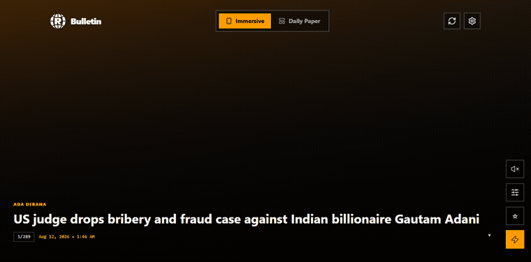

# Bulletin — News, reimagined

An always-listening news app for a generation that scrolls and listens instead of
reading headline grids. Pick your sources and topics, and the app becomes your
personal daily paper — read it, scroll it, or have it narrated to you.



## What's inside
- **TikTok-style vertical news scroll** (`BulletinFeedScroll`) — one story per screen, snap scroll.
- **Multi-image auto-switching** (`AutoImageReel`) — when an article has several images, they crossfade automatically (Dhivehi-friendly, respects `prefers-reduced-motion`).
- **Listen (TTS)** — switchable in Settings:
  - **Browser WebSpeech** (default) — free built-in system voices. Zero download, zero API key, works on every device.
  - **AWS Polly** — studio-quality neural voices (Matthew, Joanna, Amy, Stephen…) via the official Polly API. Free tier: 1M neural characters/month. Needs AWS credentials (see "AWS Polly setup" below).
  - **Keyless Dhivehi (dhivehi.mv)** — Common Voice-based Dhivehi TTS via a Worker proxy. No API key, no download. Used automatically when Dhivehi news is enabled.
- **Daily Brief / Daily Paper** — on-device brief generator (`generateNewsBrief`) groups today's stories by source into a personalized newspaper. An optional Groq pass (`GROQ_API_KEY`) polishes the writing when a key is set; otherwise it falls back to the on-device generator. Fully configurable in Settings (topics, sources, size, AI toggle).
- **Multilingual** — `en` + `dv` (Dhivehi) UI strings; independent TTS narration language; full RTL layout for Thaana (`textDirection`).
- **Easy setup** — pick interests → sources auto-onboard. No RSS pasting.

## Run it locally (dev server)
```bash
npm install
npm run dev      # http://localhost:3000  (Express + Vite middleware)
```

## Deploy to Cloudflare Workers
This project is a Cloudflare Workers SPA: the static build is served by the
**Static Assets** binding, and `/api/*` requests are handled by the Worker
(`src/worker.ts`). WebSpeech runs entirely in the browser, so it needs
no Worker-side code. AWS Polly runs server-side in the Worker (needs creds).
The Dhivehi TTS engine proxies dhivehi.mv from the Worker (keyless, no creds).

```bash
npm install
npm run build            # builds the SPA into ./dist
npx wrangler login       # one-time browser auth (or set CLOUDFLARE_API_TOKEN)
npm run deploy           # npm run build && wrangler deploy
```

Preview locally with `npm run cf:dev` (serves `dist/` + Worker routes via
`wrangler dev`).

### `wrangler.jsonc` highlights
- `main`: `src/worker.ts`
- `assets.directory`: `./dist`, `not_found_handling: "single-page-application"`
- `compatibility_flags`: `["nodejs_compat"]` (for `crypto.subtle` / WebSocket / AWS SDK)

## AWS Polly setup (for the cloud TTS engine)

Polly needs AWS credentials. They stay server-side — never shipped to the browser.

### 1. Create an AWS account
- Go to https://aws.amazon.com → **Create an AWS Account** (free tier eligible).
- You'll need a phone number + card for identity verification (no charges on free tier).

### 2. Create an IAM user with Polly access (console walkthrough)
1. Sign in to the **AWS Console** → open **IAM** (search "IAM").
2. Left menu → **Users** → **Create user**.
3. Name it e.g. `bulletin-polly`. Leave "Provide user access to the AWS Management Console" **unchecked**. Click **Next**.
4. **Set permissions** → choose **Attach policies directly**.
5. Search and tick **`AmazonPollyReadOnlyAccess`**. (Read-only is enough — Polly synthesis is a read action.) Click **Next** → **Create user**.
   - Free-tier tip: `AmazonPollyReadOnlyAccess` is sufficient and safest. Don't grant `AdministratorAccess`.
6. Open the new user → **Security credentials** tab → **Create access key**.
7. Choose **"Third-party service"** (or "Command Line Interface") → **Next** → **Create key**.
8. **Copy the Access key** and **Secret access key** now — the secret is shown only once.

### 3. Give the key to the app
**Local dev** — create a `.env` file in the project root:
```bash
AWS_ACCESS_KEY_ID=AKIA...your-access-key
AWS_SECRET_ACCESS_KEY=your-secret-key
AWS_REGION=us-east-1      # pick the region closest to you
```
Then `npm run dev`. The `/api/tts/polly` route reads these automatically.

**Cloudflare Worker (prod)** — set them as secrets so they're never in the repo:
```bash
npx wrangler secret put AWS_ACCESS_KEY_ID
npx wrangler secret put AWS_SECRET_ACCESS_KEY
npx wrangler secret put AWS_REGION
```
(Or add them to `.dev.vars` for local `wrangler dev`.)

### 4. Pick a voice
In the app → **Settings → TTS Engine → AWS Polly (Cloud)** → choose a voice
(Matthew/Joanna/Amy/Stephen/Danielle/Kajal). Tap the play button to preview.
The free tier covers ~1 million neural characters/month (~10–15 hours of audio).

### Cost
- Neural voices: **first 1M chars/month free**, then ~$16 / 1M chars.
- Standard voices: **first 5M chars/month free**.
- A daily 3-minute brief is a few thousand chars — comfortably within free tier.

> **Edge TTS removed:** the old reverse-engineered Edge TTS WebSocket was killed by
> Microsoft (returns 401/403 as of 2026-08), so it was replaced by AWS Polly for the
> cloud-quality path and browser WebSpeech for the zero-config free path.

## Firebase TTS cache (shared, cross-device)

The app can read existing Polly audio entries from Firestore and falls back to live
AWS Polly synthesis when no cache entry is available. **Anonymous Firestore writes
are intentionally disabled in the current security rules.** The previous public
write/delete rules allowed anyone to poison or erase shared cache records.

To enable new shared cache entries safely, configure a trusted server-side Firebase
identity and route cache writes/sweeps through that backend. Do not restore public
Firestore write permissions or put service-account credentials in the browser or
repository. Until that backend is configured, Polly synthesis still works, but new
audio may not persist to the shared Firestore cache.

For local development, AWS Polly credentials belong in ignored local environment
files. In Cloudflare Workers, set AWS credentials as Worker secrets. Never commit
real credentials or place them in `VITE_*` variables.

## Notes
- Standalone mode fetches RSS via a public RSS→JSON proxy in `feedClient.ts`, with
  a server-side `/api/feed-proxy` fallback for CORS/Cloudflare-blocked feeds.
- Dhivehi TTS voice may be absent on some devices; the app detects this and shows an install hint.
